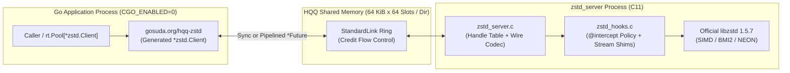

# Architecture and Internals (`gosuda.org/hqq-zstd`)

This document describes the shared-memory session geometry, credit flow control, exposed IDL surface, security interceptors, error mappings, and `cgo` comparison benchmarks of `gosuda.org/hqq-zstd`.

---

## 1. Session Geometry and Flow Control

Each `*zstd.Client` owns an HQQ `StandardLink` shared-memory session backed by a dedicated thread inside `zstd_server`. Single-frame payloads (`<= 65,501` bytes at the default 64 KiB frame size) serialize directly into the shared-memory ring slot with zero heap allocations (`0 allocs/op`), while larger buffers up to 64 MiB stream across multi-frame `CONT` sequences.



`zstd.DefaultOptions()` and `server/main.c` negotiate a wider ring geometry than the 16 KiB `rt.Options{}` default:

| Parameter | Default Value | Rationale |
| :--- | ---: | :--- |
| Frame size `S` | `65,536` (`64 KiB`) | Any call whose output capacity is `<= 65,501 B` (65,520 B frame body minus 19 B framing header) fits in a single response frame (`rf = 1`) and writes directly into the response ring slot without server scratch buffering. |
| Frame count `B` | `64` | Matches `max_in_flight = 64` (8 MiB total segment size per session: `2 * 64 * 65536`). |
| `max_message` | `128 MiB` | Accommodates a 64 MiB uncompressed payload plus worst-case `CompressBound` overhead. Requests exceeding the negotiated limit fail locally with `rt.ErrInvalidArg`. |
| `max_buffer_size`, `max_segment_bytes` | `1 MiB`, `256 MiB` | Allows callers to request up to 1 MiB frames (`B = 64` -> `128 MiB` segment). |
| `scratch_keep` | `8 MiB` | Retains per-session multi-frame reassembly scratch buffers up to 8 MiB across calls. |
| `serialize` | `none` | Independent sessions execute concurrently across CPU cores. |

### Credit-Controlled Pipelining Depth (`floor(B / rf)`)

`hqq-bindgen` credit flow control admits $\lfloor B / \mathit{rf} \rfloor$ concurrent calls in flight per session, where $\mathit{rf}$ is the number of 64 KiB response frames required for `CompressBound(n)` at `B = 64`:

| Uncompressed Input `n` | Response Frames (`rf`) | Max Concurrent Calls in Flight |
| ---: | ---: | ---: |
| up to `16 KiB` | `1` | `64` |
| `64 KiB` | `2` | `32` |
| `256 KiB` | `5` | `12` |
| `1 MiB` | `17` | `3` |
| `2 MiB` | `33` | `1` |
| `4 MiB` and above | `>= 65` | `1` (synchronous fallback since `rf > B`) |

---

## 2. Exposed IDL Surface and Security Policy

[`../zstd.idl`](../zstd.idl) defines the opcode allowlist and server-side parameter interceptor ([`../server/zstd_hooks.c`](../server/zstd_hooks.c)):

| Function | Category | Behavior |
| :--- | :--- | :--- |
| `ZSTD_compress`, `ZSTD_decompress` | One-shot | Writes into caller-sized `out dst: bytes`; errors mapped via `@error(predicate(ZSTD_isError), detail(...))`. |
| `ZSTD_compressBound` | Scalar | Also computed locally in Go via `zstd.CompressBound(n)` with zero IPC cost. |
| `ZSTD_getFrameContentSize` | Scalar | Bounds input to `ZSTD_FRAMEHEADER_MAX` (`18` bytes); returns `ZSTD_CONTENTSIZE_UNKNOWN` (`^uint64(0)`) or `ZSTD_CONTENTSIZE_ERROR` (`^uint64(1)`). |
| `ZSTD_versionNumber`, `ZSTD_versionString`, `ZSTD_minCLevel`, `ZSTD_maxCLevel` | Metadata | Zero-work scalar queries (`ZSTD_versionNumber` is `BenchmarkTrivialCall`). |
| `ZSTD_createCCtx`, `ZSTD_freeCCtx`, `ZSTD_createDCtx`, `ZSTD_freeDCtx` | Handles | `@error(null)` on creation; `free*` consumes and destroys the session handle. |
| `ZSTD_compressCCtx`, `ZSTD_decompressDCtx` | Context one-shot | Reuses context allocations across calls without re-allocating state. |
| `ZSTD_CCtx_setParameter` | `@intercept` | Permits `compressionLevel`, `windowLog` (`<= 27`), `strategy`, `contentSizeFlag`, `checksumFlag`, and `dictIDFlag`; rejects `nbWorkers` and unbounded memory parameters (`hashLog`, `chainLog`, `windowLog > 27`) with `rt.ErrDenied`. |
| `ZSTD_CCtx_setPledgedSrcSize`, `ZSTD_CCtx_reset`, `ZSTD_DCtx_reset` | Context state | Resets context state or pledges uncompressed input length. |
| `ZSTD_compressStream2_flat`, `ZSTD_decompressStream_flat` | Streaming `shim` | Flattens `ZSTD_inBuffer` / `ZSTD_outBuffer` into `(remaining, out, consumed)` for streaming compression and decompression. |

---

## 3. Error Code Mapping

When any `size_t` function fails, the client returns `*rt.LibError` where `zstd.ErrorCodeOf(err)` extracts the `ZSTD_ErrorCode` and `Detail` holds `ZSTD_getErrorName(ret)`:

| Operation | `zstd.ErrorCode` | `ZSTD_ErrorCode` | `Detail` String (zstd 1.5.7) |
| :--- | :--- | ---: | :--- |
| `Decompress` on non-zstd bytes | `ErrPrefixUnknown` | `10` | `Unknown frame descriptor` |
| `Decompress` on a frame with a reserved block type | `ErrCorruptionDetected` | `20` | `Data corruption detected` |
| `Decompress` on a frame with a corrupted payload byte | `ErrChecksumWrong` | `22` | `Restored data doesn't match checksum` |
| `CCtxSetParameter` with an out-of-range value | `ErrParameterOutOfBound` | `42` | `Parameter is out of bound` |
| `CCtxSetParameter` mid-stream when stage forbids changes | `ErrStageWrong` | `60` | `Operation not authorized at current processing stage` |
| `Compress` or `Decompress` into an undersized `dst` slice | `ErrDstSizeTooSmall` | `70` | `Destination buffer is too small` |
| `Decompress` on a truncated frame or oversized `CompressBound` | `ErrSrcSizeWrong` | `72` | `Src size is incorrect` |

---

## 4. Measured Performance (`hqq-zstd` vs In-Process `cgo`)

Calling the identical `libzstd` `1.5.7` C implementation via in-process `cgo` (`cgo_sync`) versus `zstd_server` (`server_sync` and `server_pipelined` with 8 calls in flight, compression level 1, Apple M1 Max):

| Payload Size | `cgo_sync` Compress | `server_sync` Compress | `server_pipelined` Compress | Pipelined / `cgo` Ratio |
| ---: | ---: | ---: | ---: | ---: |
| `64 B` | `911.5 ns` | `1,271 ns` | `1,044 ns` | `1.15x` |
| `1 KiB` | `4,618 ns` | `5,559 ns` | `5,020 ns` | `1.09x` |
| `64 KiB` | `160.8 µs` | `190.0 µs` | `162.8 µs` | **`1.01x`** |
| `1 MiB` | `2.784 ms` | `2.887 ms` | `2.778 ms` | **`1.00x`** |
| `64 MiB` | `180.5 ms` | `187.8 ms` | *(sync fallback)* | **`1.04x`** (sync) |

Decompression latency across the same sweep:

| Payload Size | `cgo_sync` Decompress | `server_sync` Decompress | `server_pipelined` Decompress | Pipelined / `cgo` Ratio |
| ---: | ---: | ---: | ---: | ---: |
| `64 B` | `232.5 ns` | `517.8 ns` | `329.0 ns` | `1.41x` |
| `1 KiB` | `2,024 ns` | `3,586 ns` | `2,301 ns` | `1.14x` |
| `64 KiB` | `49.82 µs` | `77.63 µs` | `53.32 µs` | **`1.07x`** |
| `1 MiB` | `697.9 µs` | `836.0 µs` | `731.7 µs` | **`1.05x`** |
| `64 MiB` | `44.59 ms` | `57.67 ms` | *(sync fallback)* | `1.29x` (sync) |

---

## 5. Build, Test, and Benchmark Commands

Fetch the pinned Zstandard source (`v1.5.7`), compile `zstd_server`, and run the test and benchmark suites:

```bash
eval "$(./build.sh)"
go test -race -tags zstdcgo ./...
go test -tags zstdcgo -run '^$' -bench . -benchtime 1s ./...
```

Regenerate the Go client and C server dispatch glue from [`../zstd.idl`](../zstd.idl):

```bash
go generate ./...
```
